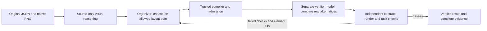

# Three-role agentic reflow harness

This opt-in harness connects source visual reasoning, organization, and visual
verification. It preserves the default offline submission entry point. It does
not train models or qualify a checkpoint just because its JSON is valid.



The analyzer receives no target dimensions or repair feedback. The organizer
receives its source-bound observations and a short list of measured failures.
The verifier uses the existing critique protocol: the original plus two actual
admitted candidate PNGs. Models return known plan/candidate IDs, never new
geometry or permission to change copy, fonts, colors, assets, or grouping.
Backend contract and canvas checks remain authoritative.

## Run the fundamental control

From the repository root, with normal runtime dependencies installed:

```powershell
.\.venv\Scripts\python.exe -m experiments.agentic_graph --fundamentals --baseline-only --out output/agentic-graph/control-new --max-seconds 120
```

Choose a new output path for each run. Four authored development tasks cover
identity, proportional resizing, portrait-to-landscape reflow, and keeping an
action label with its supporting shape. These are synthetic software checks,
not a held-out visual benchmark or training labels. The report explicitly says
`baseline_only`; it never claims three models ran.

## Run real model roles

`LocalModelRoles` accepts a JSON configuration with `analyzer`, `organizer`, and
`verifier`, each a fixed command array or an object containing `command`, plus
`timeout_seconds`. The commands consume one JSON request on stdin and emit the
existing versioned analysis/decision plus execution receipt. The existing
`experiments.visual_planner.provider --config <provider-config>` protocol is
supported; a trained adapter needs a loader that actually loads and verifies its
specific base/adapter. Merely assigning three role names to a pretrained provider
is not three fine-tuned agents.

After the training owner writes the actual pinned role configuration:

```powershell
.\.venv\Scripts\python.exe -m experiments.agentic_graph --task input/chameleon_sample_level2_core.json --config output/agentic-graph/roles.json --out output/agentic-graph/model-run-new --max-rounds 4 --max-seconds 600
```

Commands run sequentially through the existing supervised offline subprocess
boundary. This harness starts no GPU training or model downloads. The training
owner retains exclusive GPU scheduling. Three adapters may share one public
frozen base; their identities and results must remain distinct.

## Communication, acceptance, and stopping

Every role result stores its exact request, response, decision/analysis, and
execution receipt. Source pixels, source JSON, candidate menus, analysis
sidecars, target canvases, and transmitted requests are bound by hashes.
`messages.jsonl` is flushed and fsynced as a hash-linked sequence of sender,
recipient, round, source/target identities, payload, and parent-message digest.
`state.json` is published atomically after baseline and completed rounds and
retains the last verified result if later work fails. Runs never overwrite an
existing evidence directory. An interrupted run stays available for inspection;
start a new run for a retry rather than mutating that evidence.

Independent verification checks exact identity, font availability, glyph fit,
image proportions, rotated canvas bounds, native render dimensions, and resource
integrity. Task criteria additionally require a minimum font size and explicit
thresholds for collision, hierarchy, and containment proxies. These are local
diagnostics, not Adobe's scorer or proof of learned visual understanding.
Native font checks do not establish readability of lettering or QR codes baked
into image assets; retain that as unverified unless actual pixel/model review
covers it.
Unverified model choices cannot promote a current-round candidate; malformed or
stale receipts retain the prior verified design. Injected test roles are visibly
marked `injected_protocol_test` and never counted as real model execution.

The default limits are four rounds, a 600-second phase budget, and two stalled
rounds. Repeated plans/candidates, invalid or abstaining models, unavailable
alternatives, and exhausted budgets stop the graph. Provider calls are clamped
to the remaining time. Deterministic engine/render work checks the budget at
phase boundaries; it is not forcibly interrupted midway through native code.
When checks still fail, the report says so and retains failure evidence. The
loop never relaxes criteria until it can declare success.

The existing reserve-source exclusions apply before rendering. Graph feedback
is diagnostic evidence, not automatically accepted training supervision. Keep
family-disjoint train/validation/test data and image-swap/order-bias/collapse
controls when evaluating new adapters.

## Preserve weights and exact training progress

After publishing a complete checkpoint, the trainer can call:

```python
from tools.checkpoint_backup import backup_checkpoint

receipt = backup_checkpoint(published_checkpoint)
```

The helper creates a new verified generation under `local_backups/checkpoints`.
It copies every checkpoint file and never prunes or overwrites old generations.
Use its `verify` and `restore` CLI commands to check hashes and restore into a new
directory. Keep base weights in the persistent verified cache; retain public
base revision and file hashes with every adapter. Configuration, data, code,
optimizer, scheduler, RNG, and progress are required for exact continuation.

A PEFT-only adapter directory can preserve learned weights while lacking
optimizer/RNG state. Label that as a weights-only warm start, not exact resume.
The current purpose step-8 weights and the older compatibility checkpoint have
both been independently backed up and restored with matching file trees.

The lightweight guardian can also watch completed checkpoint directories:

```powershell
.\.venv\Scripts\python.exe -m tools.checkpoint_backup watch --runs-root output/visual-finetune/runs --state local_backups/checkpoint-guardian/state.json --max-seconds 21600 --until-utc 2026-10-31T06:31:00Z --poll-seconds 5
```

It recognizes existing verified snapshots, backs up newly published adapter
identities, retries incomplete saves, and records only changed states. It never
loads Torch/models, edits the source checkpoint, or deletes an older snapshot.
The deadline caps this sprint's watcher; it does not authorize a cloud session.
